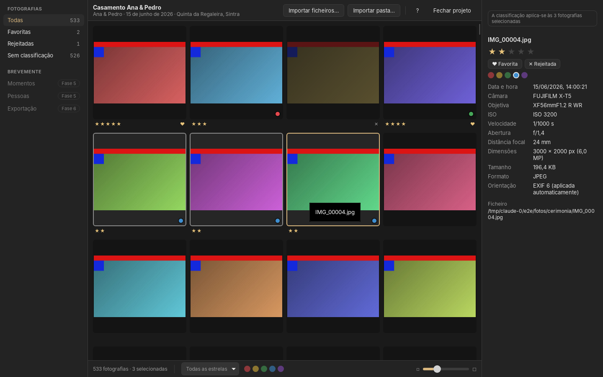

# Momento Studio *(nome provisório)*

Aplicação desktop local para gestão, seleção, edição, exportação e entrega de fotografia
de casamentos e outros eventos. Pensada para trabalhos de 3 000 a 15 000 fotografias, com
automatização em cada passo e o controlo final sempre do fotógrafo.

> **Estado atual: Fase 1 concluída (v0.1.0) — aplicação utilizável.** Criar e abrir
> projetos, importar JPEG/PNG/TIFF (ficheiros, pastas, subpastas, arrastar e largar),
> miniaturas em segundo plano, grelha, visualizador, classificação e atalhos. Tudo fica
> guardado em SQLite. Ainda **não** lê RAW nem edita (Fases 2 e 4).
> Ver [`PROJECT_STATUS.md`](PROJECT_STATUS.md).



Plataformas-alvo: **macOS** (Apple Silicon e Intel) e **Windows 10/11**.

## Princípios

- Funciona localmente, sem Internet obrigatória.
- Os originais nunca são alterados nem apagados automaticamente.
- Edição não destrutiva (receitas de parâmetros num catálogo SQLite).
- Processamento local de rostos e IA; nada é enviado para fora sem autorização.
- Compatibilidade abrangente com formatos profissionais, RAW e formatos modernos, com
  sistema extensível de codecs.

## Stack

Tauri 2 · React 19 · TypeScript · Rust · SQLite · LibRaw · LittleCMS 2 · ONNX Runtime /
Core ML. Justificação completa em [`ARCHITECTURE.md`](ARCHITECTURE.md).

## Início rápido

```bash
pnpm install
```

```bash
pnpm dev
```

Requisitos e instruções completas: [`INSTALLATION.md`](INSTALLATION.md) e
[`DEVELOPMENT.md`](DEVELOPMENT.md).

## Documentação

| Documento | Conteúdo |
|---|---|
| [ARCHITECTURE.md](ARCHITECTURE.md) | Arquitetura, decisões e incompatibilidades |
| [ROADMAP.md](ROADMAP.md) | Fases 0–9 e critérios |
| [PROJECT_STATUS.md](PROJECT_STATUS.md) | O que funciona realmente hoje |
| [INSTALLATION.md](INSTALLATION.md) | Instalação e execução |
| [DEVELOPMENT.md](DEVELOPMENT.md) | Convenções de desenvolvimento |
| [TESTING.md](TESTING.md) | Estratégia e comandos de testes |
| [SUPPORTED_FORMATS.md](SUPPORTED_FORMATS.md) | Formatos de leitura e estado de teste |
| [EXPORT_FORMATS.md](EXPORT_FORMATS.md) | Formatos de exportação |
| [PRIVACY.md](PRIVACY.md) | Privacidade |
| [SECURITY.md](SECURITY.md) | Segurança |
| [LICENSES.md](LICENSES.md) | Dependências e licenças |
| [CHANGELOG.md](CHANGELOG.md) | Histórico de versões |

## Estrutura

```
apps/desktop/          Aplicação (React em src/, Tauri/Rust em src-tauri/)
packages/              Módulos: crates Rust do núcleo + ui e localization (TypeScript)
models/                Manifesto de modelos de IA (pesos fora do Git)
tests/                 Fixtures sintéticas e documentação de testes
scripts/               Scripts de verificação e utilitários
docs/                  Documentação adicional e capturas de ecrã
```

Uso pessoal. Sem licença de distribuição definida.
